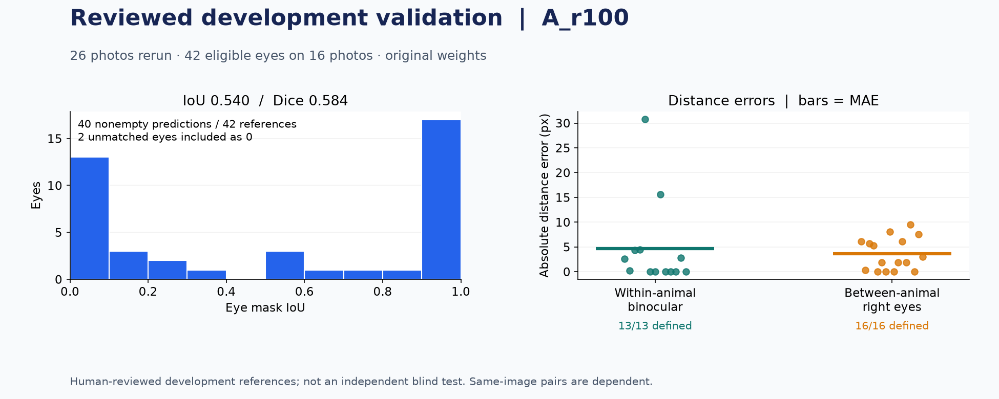
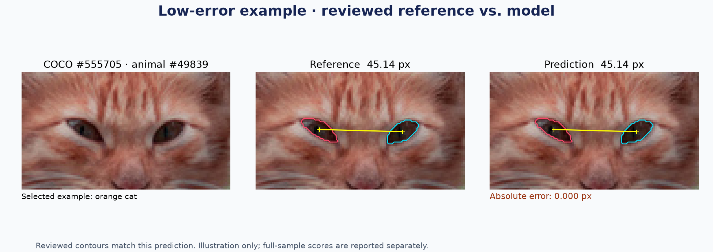
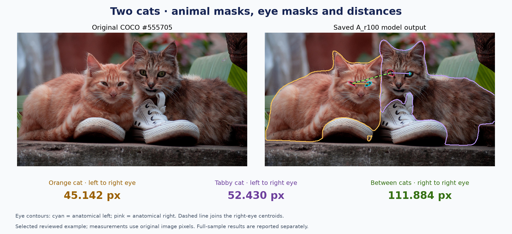
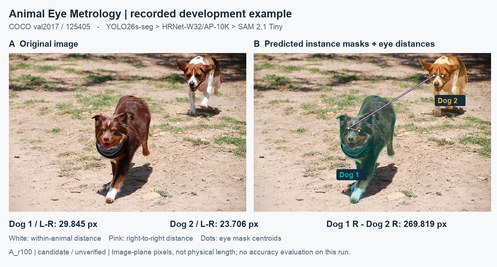
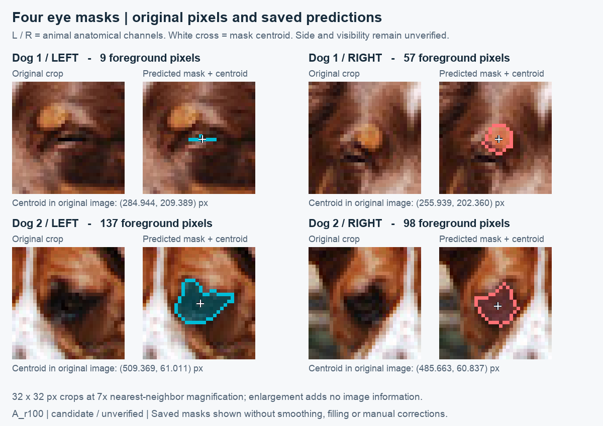

# Animal Eye Metrology

以 COCO 2017 多動物影像示範：**動物實例分割 → 眼部定位與分割 → 雙眼及跨動物右眼距離**。
提供 Streamlit 介面、FastAPI API、Docker 部署與 CSV／PNG／JSON 下載。
交付固定使用 YOLO26s-seg → HRNet-W32／AP-10K → SAM 2.1 Tiny，ROI 採 A_r100。

距離是原圖上的**眼部遮罩重心距離（px）**，不是瞳孔距離或公分。
新圖結果標記 `candidate / unverified`；沒有人工參考時不產生準確率或誤差。

## Reviewed Validation Results

2026-11-10 固定目前已保存的 v2 人工審核，對 **26 張 COCO 多動物照片**重新執行原模型與 A_r100。
其中 **16 張、42 眼**符合量測參考條件；其餘眼睛的模糊、遮擋、未審核等狀態完整保留。



| 評估項目 | 本次結果 | 分母／可計算數 |
| --- | ---: | --- |
| 眼睛 Mean IoU／Dice | **0.540／0.584** | 42 眼，含 2 眼無法配對而記 0 |
| 平均遮罩重心誤差 | **3.683 px** | 40／42 眼可計算 |
| 同隻動物雙眼 MAE／RMSE | **4.665／9.769 px** | 13／13 組，來自 8 張圖 |
| 不同動物右眼 MAE／RMSE | **3.576／4.783 px** | 16／16 組，來自 7 張圖 |

**單隻貓：眼部輪廓與雙眼距離**



展示選用 COCO `555705` 左側橘貓（動物 `49839`）：雙眼距離參考與預測皆為 **45.142 px**，
與本次審核參考的差為 **0 px**。本例審核後的輪廓與既有預測相同，作為流程展示；整體表現以上表完整驗證為準。

**兩隻貓：完整動物輪廓、眼部遮罩與跨動物距離**



同張 COCO `555705` 圖片展示橘貓與虎斑貓，量測均使用原圖眼部遮罩重心：

| 量測 | 模型距離 |
| --- | ---: |
| 橘貓雙眼 | 45.142 px |
| 虎斑貓雙眼 | 52.430 px |
| 兩隻貓的右眼 | 111.884 px |

這是**人工審核的小樣本開發驗證**，部分參考已有模型預測曝光，不能當作獨立泛化準確度。
雙眼距離最大誤差達 **30.754 px**；距離算得出來不代表量測合格。跨右眼 16 組中有 10 組來自同一張圖，配對並非獨立樣本。
[完整結果、逐眼／逐距離 CSV 與重現步驟](examples/reviewed_validation/README.md) 保留失敗與排除分母；
原本三張示範圖的歷史結果另列於 [Methodology](docs/methodology.md#recorded-observations)，不混合比較。

## Assignment Deliverables

| 要求 | 交付位置 |
| --- | --- |
| 完整程式碼 | `src/`、`app/`、`scripts/`、`tests/` |
| 介紹、技術棧、本機與 Docker 步驟 | 本文件 |
| API 文件 | [API Guide](docs/api.md)；啟動後的 [Swagger UI](http://127.0.0.1:8000/docs) |
| 測試帳號 | 不適用；本機展示沒有登入流程，也不需 AI API key |
| 環境變數範例 | [.env.example](.env.example) |
| 測試資料 CSV | [measurements.csv](examples/measurements.csv)、[來源與欄位](examples/README.md) |
| 系統架構圖 | [Architecture](docs/architecture.md) |
| 模型理由、量測公式與驗證 | [Methodology](docs/methodology.md) |

## Demonstrated Results

COCO 2017 validation `125405` 包含兩隻狗。下圖來自 2026-11-09 實際執行的
YOLO26s-seg → HRNet-W32／AP-10K → SAM 2.1 Tiny、A_r100 固定流程；
以保存的原圖與二值遮罩繪製，沒有人工修正預測或使用 GT 引導推論。

**動物實例分割：**不同顏色呈現各動物的預測輪廓，而非以矩形框代替遮罩。



**各別眼睛與量測：**放大圖呈現各眼預測遮罩與重心；L／R 是動物自身的解剖側別。
放大僅供檢視，不增加原圖資訊。量測使用原圖座標，單位為 px。



| 量測 | 結果（px，顯示至小數三位） |
| --- | ---: |
| animal_0001 雙眼 | 29.845 |
| animal_0002 雙眼 | 23.706 |
| animal_0001 與 animal_0002 右眼 | 269.819 |

本次數值與 [既有範例 CSV](examples/measurements.csv) 一致。
圖檔、來源雜湊及重繪方式見 [範例說明](examples/README.md#demonstration-figures)。
這是開發圖的流程展示，所有距離仍為 `candidate / unverified`，不代表眼睛側別、可見性或精度已通過驗收。

| 題目任務 | 實作與說明 |
| --- | --- |
| COCO 至少兩隻動物 | [示範圖來源與取得方式](#coco-example) |
| 動物及個別眼睛輪廓 | 上述實際遮罩；UI 可分別檢視與下載 |
| 每隻雙眼及任意兩隻右眼距離 | 同動物 L/R、跨動物 R/R 無序配對；缺失端點不補零 |
| 模型、原因及評估公式 | [模型選擇與 IoU／Dice、MAE／RMSE](docs/methodology.md) |
| 量測方式、公式與驗證 | [遮罩重心與歐氏距離](docs/methodology.md#measurement-and-formula-verification)、[CSV 獨立驗算](examples/README.md#read-and-verify) |

## Technology Stack

| 部分 | 採用技術與用途 |
| --- | --- |
| 應用 | Python 3.11、Streamlit、FastAPI／Uvicorn；本機檔案保存 |
| 動物輪廓 | YOLO26s-seg／Ultralytics 8.4.0，輸出各動物框與實例遮罩 |
| 眼點 | HRNet-W32／AP-10K，提供解剖左右眼通道與位置 |
| 眼部遮罩 | SAM 2.1 Tiny，以預測眼點及局部 ROI 分割 |
| 重現與品質 | 固定來源 commit／權重 SHA-256、CPU FP32、seed 42、4 threads、Pytest、Ruff |

三個模型分別負責不同子任務。專案包含動物分割微調、學習率診斷與再評估；
目前推論仍採原始預訓練權重。方法、歷史結果及重現命令見 [Training](docs/training.md)。
介面的「訓練與實驗」頁籤預設顯示最新大型訓練比較表、保留原始權重的原因與比較 CSV 下載；
亦可切換早期小樣本實驗、曲線與紀錄。最新擴大實驗摘要見下節。
應用使用 Torch 2.9.1，HRNet 使用 Torch 2.2.2／MMCV 2.1.0，以兩個 Python 環境隔離相依。

## Latest Training Result and Model Decision

2026-11-09 已完成 YOLO26s-seg 擴大微調：COCO train2017 **7,727 張訓練／950 張 development／950 張 holdout**，
從原始預訓練權重開始，訓練 3 epochs、11,592 次更新。下表為十動物類的 COCO Mask AP@[.50:.95]（0–100），
各欄均在同一組圖片上比較原始模型與最佳微調 epoch：

| YOLO26s-seg 權重 | Development AP（950 張，供選模） | Holdout AP（950 張，選模凍結後評估） |
| --- | ---: | ---: |
| 原始預訓練 | **58.38** | **59.01** |
| 微調最佳 epoch 1 | 53.68 | 54.68 |
| 微調 − 原始（AP 點） | −4.70 | −4.33 |

**最終保留原始權重：**微調未超過原始模型的 development AP，因此在 holdout 推論前就凍結選擇為原始模型；
後續 holdout 比較也未顯示改善。微調權重已匯出保存，但沒有切換至正式推論。
動物分割 AP 不代表眼部遮罩或眼距精度，替換權重後的端到端眼距比較也尚未完成。
正式流程維持原始 YOLO26s-seg → HRNet-W32／AP-10K → SAM 2.1 Tiny、A_r100。

這是單一 seed 的專案留出評估；COCO train2017 可能已用於上游預訓練，不能稱為模型完全未見的獨立測試。
也不能與較早 fresh64 的 AP 差異直接混比。[完整設定、逐 epoch 結果與限制](docs/training.md#expanded-yolo26s-experiment)、
[保存結果](examples/training/expanded_yolo26s_job_status.json) 與 [選模凍結紀錄](examples/training/expanded_yolo26s_selection.json)
提供核對依據。本節整理既有實驗，沒有重新訓練或評估。

## Local Setup

支援 Python 3.11、macOS arm64 或 Linux amd64。MMCV CPU operators 必要時由原始碼編譯，
需要 C/C++ 編譯工具；安裝套件與模型時需要網路。從專案根目錄執行：

```sh
cp .env.example .env
python3.11 scripts/bootstrap.py --all
python3.11 scripts/prepare_models.py --download
python3.11 scripts/check_runtime.py --config configs/inference.runtime.toml --load-models
```

`bootstrap.py` 依平台鎖定檔建立 `.runtime/app`、`.runtime/pose`，拒絕覆寫成功建立的環境。
已有權重時以 `python3.11 scripts/prepare_models.py` 檢查即可；一般推論不自動下載。
安裝中斷時先檢查 `.runtime/environment_*.json`；只有失敗／已停止且設定一致的建置可用
`--app --resume` 或 `--pose --resume` 接續。套件版本見 `requirements/` 的四份平台鎖定檔。

啟動介面：

```sh
AEM_INFERENCE_CONFIG=configs/inference.runtime.toml \
  .runtime/app/bin/python -m streamlit run app/streamlit_app.py \
  --server.address 127.0.0.1 --server.port 8517 --browser.gatherUsageStats false
```

開啟 [本機介面](http://127.0.0.1:8517)，上傳圖片、執行推論，檢視動物／眼部遮罩與兩種距離。
另一個終端機可啟動 API：

```sh
AEM_INFERENCE_CONFIG=configs/inference.runtime.toml \
  .runtime/app/bin/python -m uvicorn animal_eye_metrology.api:app \
  --host 127.0.0.1 --port 8000 --workers 1
```

`.env` 供 Compose 讀取；本機 Python 指令明確設定 `AEM_INFERENCE_CONFIG`。
CLI 使用同一流程：

```sh
.runtime/app/bin/python -m animal_eye_metrology --image data/000000125405.jpg
```

## Eye Annotation

「眼睛標註與審核」頁籤提供 v2 人工輪廓、草稿與審核、版本保存與遮罩下載。
準備工作區與新增批次見 [Eye Annotation](docs/eye_annotation.md)。頁面不會自動訓練或更換模型。
這是另需 COCO 標註及圖片的附加工作流程；只執行上傳推論不需先準備標註工作區。
乾淨下載的專案未包含預設三圖工作區與 proposal CSV，不能直接執行 `--prepare` 而省略來源準備。
Docker 新增標註批次須先把對應 COCO JSON 放進 `data/coco/annotations/`；專案根目錄 ZIP 不會掛入容器。

## COCO Example

範例為 COCO 2017 validation 的 `125405`：兩隻狗，官方非 crowd annotation IDs
為 `13692`、`17207`。這是既有開發示範圖，不是獨立測試集。
[輸入清單](examples/input_manifest.csv) 記錄原圖網址與 SHA-256；不需下載整份 COCO。

```sh
mkdir -p data
curl --fail --location \
  https://s3.amazonaws.com/images.cocodataset.org/val2017/000000125405.jpg \
  --output data/000000125405.jpg
python3.11 - <<'PY'
import hashlib
from pathlib import Path
assert hashlib.sha256(Path('data/000000125405.jpg').read_bytes()).hexdigest() == (
    'aeb172b088be9b334a97fcd4df1fe89b5730bc5836765a23c82f2b8b4ff3d03b'
)
PY
```

## Docker

目標為 **Linux amd64、CPU**；UI 與 API 共用同一映像、各自執行程序。
取得儲存庫或解壓交件 ZIP 後，進入包含 `compose.yaml` 的專案根目錄，依序執行以下步驟。
下列指令使用 macOS／Linux shell；Docker 模式**不需要先執行 Local Setup 或建立本機 `.runtime/`**，
兩套模型環境都由 Docker 建置。

### Prerequisites

| 項目 | 準備方式與範圍 |
| --- | --- |
| Docker | 安裝並啟動 Docker Engine／Desktop，確認 `docker info` 成功；需 Compose v2，可用 `docker compose version` 檢查 |
| 主機 Python | 需要 Python 3.11，確認 `python3.11 --version`；只用於下載／核對權重與示範圖，不需先安裝模型套件 |
| 網路與建置時間 | 首次需下載基礎映像、固定套件、模型程式碼與權重，並編譯 MMCV，請預留時間 |
| 平台 | 已完整驗證 Linux amd64／CPU；Apple Silicon 使用 amd64 模擬，可能較慢，尚未完成相同的完整容器驗證；Linux arm64 原生映像／GPU 不在驗證範圍 |
| 圖片 | 先依 [COCO Example](#coco-example) 下載並核對示範圖；也可自備多動物 JPEG／PNG 上傳，但下方自動檢查使用指定示範圖 |

### Build and Start

以下採 `.env.example` 的預設埠號與目錄。若已有 `.env`，保留原設定並參閱下方路徑說明。

```sh
if [ ! -f .env ]; then cp .env.example .env; fi
mkdir -p weights data outputs
python3.11 scripts/prepare_models.py --download
docker compose config --quiet
docker compose build
docker compose up -d --wait --wait-timeout 180
docker compose ps
```

`docker compose config --quiet` 成功時沒有輸出；權重準備的三個模型應皆為 `ready`。
啟動後確認 `ui`、`api` 皆為 `healthy`。若啟動失敗或等待逾時，先查看 `docker compose logs --tail=100`。
UI：[localhost:8517](http://127.0.0.1:8517)；API：[localhost:8000/docs](http://127.0.0.1:8000/docs)。
上傳圖片後即可執行推論、檢視遮罩與兩類距離，並下載結果。

`-d` 代表背景啟動，可以繼續在同一終端機執行檢查；若使用 `docker compose up` 前景模式，
請另開終端機並進入同一專案目錄執行後續指令。

### Verify and Stop

服務啟動後，依序核對模型、容器測試及真實圖片推論：

```sh
docker compose run --rm api python scripts/check_runtime.py \
  --config configs/inference.docker.toml --load-models
docker compose run --rm api python -m pytest -q
docker compose exec -T api python scripts/smoke_api.py \
  --image data/000000125405.jpg --report outputs/api_smoke.json
docker compose logs --tail=100
```

模型檢查應回報 `ready`，測試不應有失敗，smoke 報告應為 `passed`。
smoke 包含真實圖片、兩種距離、CSV／PNG 下載、無效圖片及無動物圖片；預設報告存於主機
`outputs/api_smoke.json`。使用自己的圖片上傳不需要這份自動檢查，但不能用任意圖片替代其固定示範輸入。

展示完成後停止服務：

```sh
docker compose down
```

### Ports and Data Paths

預設只綁定主機 `127.0.0.1`，供執行 Docker 的電腦使用，**不是外網公開網站**。
若預設埠號已被占用，可修改 `.env` 的 `UI_PORT`／`API_PORT`，再執行啟動指令，並使用新的瀏覽器埠號。
容器內埠號仍為 8517／8000，因此上述透過 `docker compose exec` 執行的 smoke 指令不需跟著改埠號。

| `.env` 設定 | 主機預設位置 | 容器位置與用途 |
| --- | --- | --- |
| `WEIGHTS_DIRECTORY` | `./weights` | `/app/weights`，唯讀模型權重 |
| `DATA_DIRECTORY` | `./data` | `/app/data`，唯讀輸入資料 |
| `OUTPUTS_DIRECTORY` | `./outputs` | `/app/outputs`，保存結果；停止或移除容器後仍保留在主機 |

若把 `WEIGHTS_DIRECTORY` 改成 `./custom-weights`，下載時也必須指定相同位置：

```sh
python3.11 scripts/prepare_models.py --download --directory ./custom-weights
```

`prepare_models.py` 不會自動讀取 `.env`。自訂 `DATA_DIRECTORY` 時，將示範圖放入該目錄根層；
自訂 `OUTPUTS_DIRECTORY` 時，smoke 報告會保存在該目錄。上述容器內的 `data/`、`outputs/` 指令路徑維持不變。
請先建立自訂目錄，並確認輸出目錄可寫入。

### Validation Scope

上傳推論不需要人工標註工作區；使用「眼睛標註與審核」前，另依 [Eye Annotation](docs/eye_annotation.md#data-preparation)
準備 COCO JSON 與原圖。Docker 不會自動下載完整資料集或本機歷史工作區。

目前交付程式內容已通過 [Linux amd64 容器驗證](https://github.com/PolunLin/animal-eye-metrology/actions/runs/42669689398)：
建置、三模型載入、353 項容器測試與 10 項 API／推論下載檢查成功。
CI 的 CPU 容器檢查為選擇性執行，不能把略過當通過；工程檢查也不代替模型準確度或全部人工標註互動的驗收。

## Validation

```sh
.runtime/app/bin/python -m pytest -q
.runtime/app/bin/ruff check src tests app scripts
.runtime/app/bin/ruff format --check src tests app scripts
.runtime/app/bin/python scripts/check_delivery.py
```

測試使用隔離合成資料，驗證幾何、座標、API、失敗狀態與保存；不下載資料或模型。
啟動 API 後，可用既有示範圖檢查真實流程及下載：

```sh
.runtime/app/bin/python scripts/smoke_api.py \
  --image data/000000125405.jpg --report outputs/api_smoke.json
```

本次已用固定人工審核參考分開計算 IoU／Dice、重心誤差與兩類距離 MAE／RMSE。
可直接[重播保存的驗證結果](examples/reviewed_validation/README.md#replay-scores)，不需模型或原圖。
公式及驗證界線見 [Methodology](docs/methodology.md)。

## Review and Submission Notes

| 項目 | 評閱方式與範圍 |
| --- | --- |
| 程式與版本 | [GitHub repository](https://github.com/PolunLin/animal-eye-metrology)；提交時記錄 commit，確認評閱者有讀取權限。私人儲存庫僅分享網址不足以授權。 |
| 自動檢查 | [Project checks](https://github.com/PolunLin/animal-eye-metrology/actions/workflows/ci.yml)；查看提交 commit 的狀態。CPU 容器工作為選擇性執行，不能把略過當通過。 |
| 無需帳號 | 應用無登入流程，不需測試帳號或 AI API key；GitHub 存取權與應用帳號是不同事項。 |
| 首次啟動 | 需要網路下載固定套件與權重、編譯 MMCV；請預留建置時間。結果圖與範例 CSV 可先離線閱讀。 |
| 工程驗證 | 測試、模型載入與真圖 smoke 證明流程能執行；不等於模型精度驗收。 |
| 精度證據 | 本次 26 張開發圖、42 個合格參考眼睛的驗證見本頁開頭；另保留三張開發圖、12 眼的歷史比較。兩批皆非獨立泛化驗收。 |

固定 A_r100 對 v2 人工參考的**歷史開發觀察**：

| Mean IoU | Mean Dice | 雙眼 MAE（px） | 跨右眼 MAE（px） |
| ---: | ---: | ---: | ---: |
| 0.522 | 0.617 | 2.008 | 3.383 |

這些是平均值，不是誤差上限；IoU 不是「正確率」。距離標的是眼部遮罩重心，不是瞳孔中心或公分。
上述歷史評分、本頁單圖展示與本次 26 圖開發驗證是不同紀錄，不混合比較或據此宣稱模型進步。
歷史 [評估摘要](examples/evaluation_summary.csv) 不含完整人工 GT 與預測遮罩，完整重算需另備原始證據；
本次 [26 圖驗證包](examples/reviewed_validation/README.md#replay-scores) 則提供無損參考／預測遮罩，可直接重播評分。
訓練紀錄屬補充實驗，正式推論仍使用固定原始權重；[模型選型](docs/methodology.md#model-choice) 與
[最新訓練後保留原始權重的理由](docs/training.md#why-the-original-weights-remain) 分別說明架構與權重決策。

## Repository Layout

```text
app/                      Streamlit entry point
src/animal_eye_metrology/  API, CLI, inference, models, measurement, UI and core helpers
configs/                  Local / Docker inference and pinned model configuration
requirements/             Application / pose dependencies and platform locks
scripts/                  Environment, model, runtime and delivery checks
tests/                    Final pipeline contract and geometry tests
examples/                 Baseline and reviewed validation evidence, CSV and provenance
docs/                     API, architecture and methodology
```

訓練程式、設定、測試與精簡實驗證據納入公開交付；其他歷史研究與答辯筆記仍保存在 `local_only/`，由 Git 與 Docker 排除。
完整資料集、權重、環境及原始執行產物不提交；`examples/` 保留精簡成果圖、CSV、來源紀錄及可重播評分的參考／預測遮罩。公開推論與保存評分重播不依賴本機研究備份。

## License

自行撰寫的程式採 [MIT](LICENSE)；上游模型、套件與資料遵循各自授權：
[Ultralytics](https://github.com/ultralytics/ultralytics/blob/v8.4.0/LICENSE)、
[MMPose](https://github.com/open-mmlab/mmpose/blob/5408bc76f5b848cf925a0d1857899011d8c5b497/LICENSE)、
[SAM 2](https://github.com/facebookresearch/sam2/blob/2b90b9f5ceec907a1c18123530e92e794ad901a4/LICENSE)。
