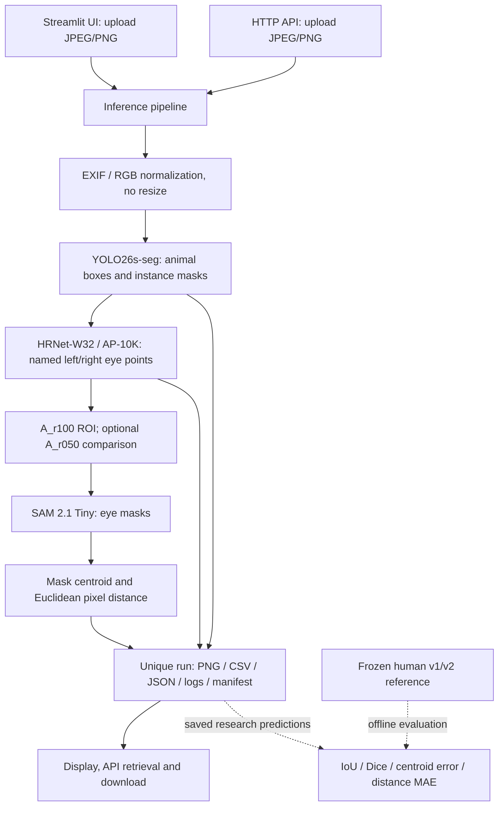
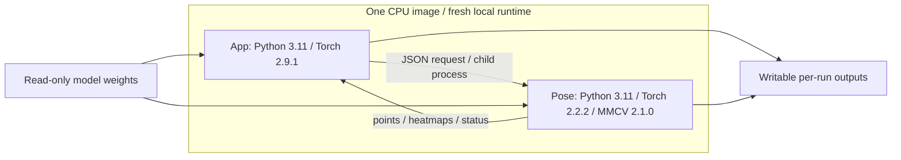

# System Architecture

## Inference Flow



新圖推論不讀 COCO 註記、舊偵測、人工點框或 GT。研究評估在推論之外，
使用凍結參考及對應預測計分，避免用 GT 選候選或修正眼點。

## Runtime Isolation



UI／API 使用同一映像、不同程序。本機 CPU 交付沒有資料庫、帳號、持久化工作佇列或 GPU 調度。
隔離環境保留既有相依版本，不透過合併 Torch 或換模型改變研究方法。
各入口共用輸出根目錄時，以 `.inference.lock` 跨程序互斥；API 另有程序內鎖。
忙碌時立即拒絕，沒有排隊；不同根目錄與不同主機不共享此執行限制。

## Python Package Layout

`src/animal_eye_metrology/` 依工作責任分組，避免把推論、介面與研究程式平放在同一層。
根目錄保留 `api.py`、`cli.py` 與 `__main__.py` 作為穩定入口；`paths.py` 統一解析
專案根目錄、worker 與來源檔案，不從各子模組的深度推算路徑。

```text
animal_eye_metrology/
├── core/          configuration, errors, execution lock and file verification
├── data/          COCO data, frozen training subsets, supply audits and outputs
├── annotation/    annotations, prompts, review stores and sessions
├── models/        segmentation, SAM runtime and YOLO training adapters
├── inference/     pipeline, workers, capability policy and run artifacts
├── measurement/   geometry, mask centroids, distances and frozen references
├── research/      training and experiment runners, comparisons and evaluation
└── ui/            Streamlit workspaces, canvas components and visualization
```

新程式使用分組後的完整匯入路徑，例如
`animal_eye_metrology.measurement.metrology`。既有平層匯入與研究命令保留相容入口，
相容名稱與新名稱共用同一模組，不產生兩套設定、執行鎖或例外類別。

### Training Tools

訓練相關程式沿用上述責任分工，不另建同名 `training/` 套件：

這些是選用的離線研究工具；一般 UI／API 推論不預先載入訓練 runner 或 YOLO loss 轉接器。
訓練時才使用指定模型環境，匯入套件根目錄不會因此載入 Torch。

| 程式 | 責任 |
| --- | --- |
| `research/training.py` | 離線監督式訓練、模型工作程序與比較彙整 |
| `data/training_data.py` | 凍結 COCO 訓練子集、原始實例遮罩與資料來源 |
| `data/segmentation_supply.py` | 研究資料供給與既有接觸範圍檢查，不自行選樣或推論 |
| `models/training_yolo.py` | 將原生實例遮罩轉接至 YOLO 訓練 loss，不改模型架構 |
| `scripts/export_training_weights.py` | 已完成 run 的原生權重匯出與重新載入核對 |

舊匯入與獨立命令仍有效；以下兩個入口只顯示使用說明，不啟動訓練：

```sh
.runtime/app/bin/python -m animal_eye_metrology.research.training --help
.runtime/app/bin/python -m animal_eye_metrology.training --help
```

訓練設定仍在 `configs/segmentation_training_pilot.toml`，資料、進度、checkpoint 與
匯出權重仍使用原本設定的本機路徑。實際執行需備妥相符版本的模型環境與凍結資料。
目前 runner 沒有 checkpoint resume 模式，新的 run 會拒絕覆寫已存在的模型輸出目錄；
舊命令相容不代表提供續跑功能。既有研究 manifest 與訓練產物不因程式分類而改寫。

## Responsibilities

| 模組／目錄 | 職責 |
| --- | --- |
| `app/`、`ui/` | 操作與顯示；UI 不直接混載兩套 Torch／MMCV |
| `inference/inference_pipeline.py` | 輸入正規化、串接、逾時／失敗保存、唯一 run |
| `core/execution_lock.py` | UI／API／CLI 共用輸出根目錄的協作互斥鎖 |
| `inference/inference_worker.py`、`inference/eye_pose_worker.py` | 固定模型、來源／權重驗證、原生座標輸出 |
| `measurement/`、`inference/inference_artifacts.py` | 遮罩重心、距離配對、圖片與表格 |
| `inference/inference_capabilities.py` | 十類執行政策、鳥類域外試驗標記 |
| `configs/`、`requirements/`、`scripts/` | 研究／應用設定、環境與模型準備 |
| `research/`、`annotation/` | 人工審核、版本凍結、消融與定義比較 |
| `tests/` | 合成幾何、完整性、資料保存與失敗行為驗證 |

## State and Provenance

每次推論建立時間／UUID run，不覆寫既有成果。原上傳 bytes 與正規化圖片分開保存，
座標依正規化原圖。動物遮罩失敗與眼部失敗分開記錄；缺失端點不補零。
請求、設定、日誌與 manifest 保存來源及產物雜湊。
全新環境另保存實際套件版本、固定來源 commit 與採用 lock 的 SHA-256；
bootstrap 拒絕覆寫已有環境，安裝完成仍須另外驗證模型與圖片流程。

`completed` 是程序／數值步驟完成，`candidate` 是端點足以計算；
兩者不代表眼睛可見、分割正確或量測合格。新圖量測資格維持 `unverified`。

## Repository Boundary

Git 保存程式、設定、依賴鎖定、自動測試、空輸出 Notebook、小型 CSV 範例與專案操作文件。
資料集、權重、虛擬環境、快取及每次推論的產物在本機保存。
Phase 研究文件、Agent 筆記與執行報告也只在本機保留，不包含在 Git 或 Docker 映像。
保留研究模組不代表乾淨 checkout 附帶其規範、人工參考或凍結資料；新圖推論不依賴這些研究紀錄。
