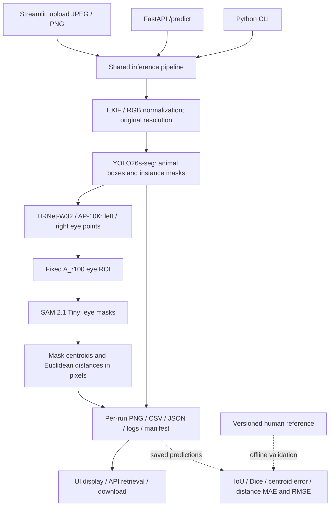

# System Architecture

## Runtime and Responsibilities

| 元件 | 責任 |
| --- | --- |
| `app/`、`ui/` | 上傳、動物輪廓、眼部放大、距離表與下載 |
| `api.py`、`cli.py` | HTTP／命令列入口，共用相同推論流程 |
| `inference/` | 輸入正規化、模型子程序、狀態保存、CSV／疊圖 |
| `models/` | 固定 SAM 2.1 Tiny 載入及官方來源檢查 |
| `measurement/` | 原圖 ROI、二值遮罩重心、距離與遮罩重疊公式 |
| `core/` | 例外、檔案完整性、跨程序執行鎖 |
| `configs/`、`requirements/` | 固定權重、模型來源、參數及平台環境 |

應用環境執行 YOLO／SAM（Torch 2.9.1）；隔離的 pose 環境執行 HRNet
（Torch 2.2.2／MMCV 2.1.0）。兩者透過 JSON 與檔案交換結果，同一 Docker 映像包含兩套環境。

## State and Validation

每次推論建立唯一 run；原始上傳與正規化圖片分開保存，座標以正規化原圖為準。
設定、程式與權重來源留有雜湊。眼睛缺失或空遮罩不補零，保留失敗原因。
API／UI／CLI 共用輸出目錄時以檔案鎖互斥，忙碌時拒絕執行；沒有排隊或跨主機排程。

推論不讀人工 GT。人工參考只供離線評分，避免用 GT 改提示或選遮罩。
`completed` 表示流程完成；`candidate` 表示端點可計算；量測資格仍為 `unverified`。
公式與驗證見 [Methodology](methodology.md)。
