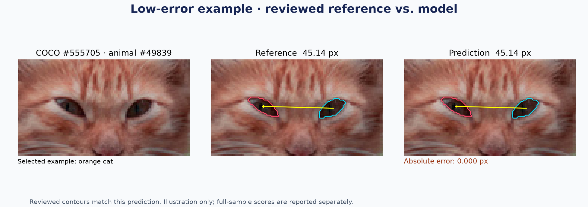
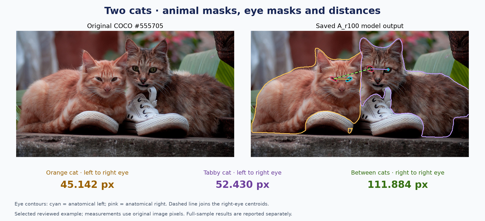

# Reviewed Development Validation

2026-11-10（Asia/Taipei）固定 Polun 已儲存的 v2 審核版本，以原始 YOLO26s-seg → HRNet-W32／AP-10K → SAM 2.1 Tiny、A_r100 重新執行推論。
沒有訓練、更換權重、改提示框或修改原標註。這是人工審核的小樣本開發驗證，並非獨立盲測。

## Results

| 指標 | 結果 | 可計算數／參考數 |
| --- | ---: | --- |
| Mean IoU | 0.539823 | 全部 42 眼，失敗記 0 |
| Mean Dice | 0.583659 | 全部 42 眼，失敗記 0 |
| 平均／最大重心誤差 | 3.682517／20.922577 px | 40／42 眼 |
| 雙眼 MAE／RMSE | 4.664664／9.769314 px | 13／13 組，8 張圖 |
| 雙眼最大絕對誤差 | 30.754107 px | 13 組 |
| 跨右眼 MAE／RMSE | 3.576064／4.783348 px | 16／16 組，7 張圖 |
| 跨右眼最大絕對誤差 | 9.489947 px | 16 組 |
| 各圖先平均的雙眼／跨右眼 MAE | 6.857775／3.448545 px | 8／7 張圖 |

模型有 2 個合格眼睛參考因動物配對缺失／歧義無法建立預測對應，IoU／Dice 依規則記 0；其餘 40 眼沒有空預測遮罩。
這兩眼是 `305695 / 1822431 / right` 與 `552371 / 58083 / left`，皆未構成完整的雙眼或跨右眼參考組，
所以距離可計算數仍為 13／13 與 16／16。

## Low-error Example

### Single-Cat Eye Detail



展示選用 COCO `555705` 左側橘貓，動物 ID `49839`。原圖包含兩隻貓，此處放大橘貓的眼部：

| 項目 | 數值 |
| --- | ---: |
| 審核參考雙眼距離 | 45.142201 px |
| 模型預測雙眼距離 | 45.142201 px |
| 與審核參考的雙眼距離差 | **0 px** |
| 左眼／右眼 IoU | 1.000／1.000 |

### Two-Cat Scene and Measurements



同張 COCO `555705` 的完整畫面呈現兩隻動物的分割輪廓、各自眼部遮罩，以及兩種距離。
左側橘貓為 `49839`，右側虎斑貓為 `49029`；右眼採動物自身解剖側別。

| 量測 | 審核參考 | 模型預測 | 與參考的絕對差 |
| --- | ---: | ---: | ---: |
| 橘貓雙眼 | 45.142201 px | 45.142201 px | 0 px |
| 虎斑貓雙眼 | 52.430373 px | 52.430373 px | 0 px |
| 兩隻貓的右眼 | 111.883620 px | 111.883620 px | 0 px |

表格來源為 [measurements.csv](measurements.csv) 的 `555705` 三筆紀錄；兩張展示圖都使用保存的預測，沒有重新推論或修飾遮罩。

本例審核後的輪廓與既有預測相同，0 px 表示與這份參考一致，用於流程展示，不代表獨立測試零誤差。
整批資料的評分仍使用前述全部參考，沒有因展示選圖而改動。
圖中只放大原圖格點供檢視，不改變遮罩或評分。
[分數分布圖](overview.png) 顯示全部合格眼睛與距離誤差。

## Larger Errors and Verification

最大雙眼誤差出現在 `240754` 的牛 `71124`：參考約 47.720 px，預測約 16.966 px，誤差 30.754 px。
平均誤差不應掩蓋此失敗案例，距離可計算也不代表適合實際測量。

[獨立重算核對](independent_audit.json) 使用另一份實作，未匯入主要評分函式；
42 眼、29 筆距離、93 筆動物配對於 `1e-12` 容忍範圍內一致，來源 1,459 檔與模型／推論相關 18 檔雜湊均維持不變。
這項核對證明數值實作與來源一致，不是獨立資料準確度驗收。

## Reference Scope

| 項目 | 數量 |
| --- | ---: |
| 已開始標註／審核並保存的照片 | 26 |
| 已逐眼做出通過或不通過判定的照片 | 23 |
| 完整目標眼睛槽位 | 186 |
| 合格參考眼睛 | 42，分布於 16 張照片、7 類動物 |
| 不通過的眼睛 | 120 |
| 待審核／未標註 | 1／23 |
| 可建立的雙眼／跨動物右眼參考距離 | 13／16 |

每隻眼採最新保存版本；不從歷史版本回選較好的輪廓。合格參考須同時符合
`Visible`、`side_confirmed=Yes`、`Accepted`、`measurement_quality=Pass`，且原圖尺寸的二值遮罩非空。
未合格的 144 個槽位保留狀態與原因，詳見 [reviews.csv](reviews.csv)。
其中 120 個不通過案例含影像模糊、不可見側、遮擋與像素不足等人工判定；這不是模型失敗數。

## Scoring Policy

1. 26 張照片全部重新執行固定推論。人工參考不作模型輸入，不調整模型眼點、ROI 或左右眼通道。
2. 使用該圖全部 COCO 動物競爭配對：同類別、動物遮罩 IoU ≥ 0.5、框 IoU ≥ 0.5、雙向最佳，且兩側最佳與次佳差距皆 ≥ 0.1。規則沿用既有身份核對；未配對／歧義保留為失敗，不用眼睛位置找最有利對應。
3. 42 個合格參考全部列入眼睛 IoU／Dice 分母。模型漏抓、無法配對或無輸出時記 0；空預測遮罩對非空參考也記 0。未合格人工槽位不參與數值評分。
4. 重心採前景像素中心 `(column + 0.5, row + 0.5)` 的平均。距離採原圖平面歐氏距離，單位 px；缺少預測端點時留空，不補零。
5. 距離 MAE／RMSE 只使用可計算預測，另報全部參考數、可計算數與缺失數。同張圖的眼睛與配對相依，並非獨立樣本。

16 組跨右眼參考中，有 10 組來自同一張照片 `439180`。主要摘要是逐眼／逐配對平均；
`summary.json` 另提供各圖先平均再平均的 `*_image_macro_mae_px`，方便看出單張多動物圖的影響。
動物身份配對的覆蓋率不是 COCO Mask AP，也不代表眼睛分割正確率。

## Evidence Files

| 檔案 | 內容 |
| --- | --- |
| [reference.json](reference.json) | 凍結的逐眼狀態、版本、原圖來源／雜湊、COCO 動物參考、合格眼睛無損 RLE、來源檔案雜湊 |
| [predictions.json](predictions.json) | 26 張圖的本次預測狀態、動物及眼睛遮罩無損 RLE；重播評分不需原圖或權重 |
| [summary.json](summary.json) | 未四捨五入總摘要、分母與失敗數 |
| [per_eye.csv](per_eye.csv) | 每個合格眼睛的 IoU／Dice、重心誤差、版本與失敗原因 |
| [measurements.csv](measurements.csv) | 兩類距離的參考、預測、誤差及缺失原因 |
| [matches.csv](matches.csv) | 全部目標動物的身份配對證據 |
| [images.csv](images.csv)、[by_category.json](by_category.json) | 逐圖／逐類別摘要；小樣本分組不作物種性能排名 |
| [reviews.csv](reviews.csv) | 完整 186 槽位的保存狀態、量測資格與排除原因 |
| [run_manifest.json](run_manifest.json) | 本次執行、CPU／seed／threads、輸入與模型來源雜湊、前後一致性檢查 |
| [independent_audit.json](independent_audit.json) | 獨立重算核對紀錄 |
| [manifest.json](manifest.json) | 公開證據與重播程式的 SHA-256 清單 |

RLE 僅壓縮二值遮罩，不進行平滑、補洞或輪廓簡化。完整原圖、原始逐階段執行紀錄及模型權重保留本機；此目錄提供可重播數值評分的精簡證據。

## Replay Scores

依專案 README 建立應用環境後，從專案根目錄執行。輸出目錄必須尚未存在：

```sh
PYTHONPATH=src .runtime/app/bin/python scripts/evaluate_reviewed.py score \
  --reference examples/reviewed_validation/reference.json \
  --predictions examples/reviewed_validation/predictions.json \
  --output outputs/reviewed_validation_replay
```

此步驟重新配對與評分已保存的二值遮罩，不載入模型、不下載圖片，也不更改標註。
輸出的摘要可與本目錄 `summary.json` 比較。

成果圖由 `scripts/plot_reviewed_validation.py` 使用保存分數與原圖生成；準備下節的原圖後可重繪：

```sh
PYTHONPATH=src .runtime/app/bin/python scripts/plot_reviewed_validation.py \
  --evidence examples/reviewed_validation --images data/reviewed_validation
```

## Repeat Inference

原始 COCO JPEG 的檔名、網址與 SHA-256 在 `reference.json` 的 `images` 中。
將全部 26 張原圖放入同一資料夾（下例 `data/reviewed_validation`），並依專案 README 準備固定模型與權重。
不要使用截圖或重新壓縮圖片，程式會核對原始位元組雜湊。

```sh
PYTHONPATH=src .runtime/app/bin/python scripts/evaluate_reviewed.py infer \
  --reference examples/reviewed_validation/reference.json \
  --images data/reviewed_validation \
  --config configs/inference.runtime.toml \
  --output outputs/reviewed_validation_fresh

PYTHONPATH=src .runtime/app/bin/python scripts/evaluate_reviewed.py score \
  --reference examples/reviewed_validation/reference.json \
  --predictions outputs/reviewed_validation_fresh/predictions.json \
  --output outputs/reviewed_validation_fresh_scores
```

原工作區歷史檔案不在 Git 中；以公開快照搭配 `--images` 重跑時，紀錄會列出無法取得的歷史來源檔，
仍核對公開參考、26 張原圖及固定權重。請將新執行結果另存，不覆寫這次保存的證據。

## Interpretation

這批參考由已保存的人工審核決定，並非隨機抽樣或獨立盲測；原開發圖亦包含其中。
部分參考已有模型預測曝光，42 眼中有 17 眼與本次預測完全重疊，因此分數可能受到參考與預測相依影響，不能據此宣稱獨立準確度。
可用來呈現固定流程在這批資料的誤差、覆蓋率與失敗情況，不足以推論所有物種或場景的準確率。
本次沒有設定產品驗收容忍值，也沒有把非空遮罩或「距離算得出來」視為量測合格。

原有三張示範圖、12 眼的歷史評分仍保留在 [原始紀錄](../README.md#recorded-evaluation)。
本次圖片、人工參考版本與端到端配對範圍不同，不能用兩張摘要的分數差異宣稱模型進步或退步。
